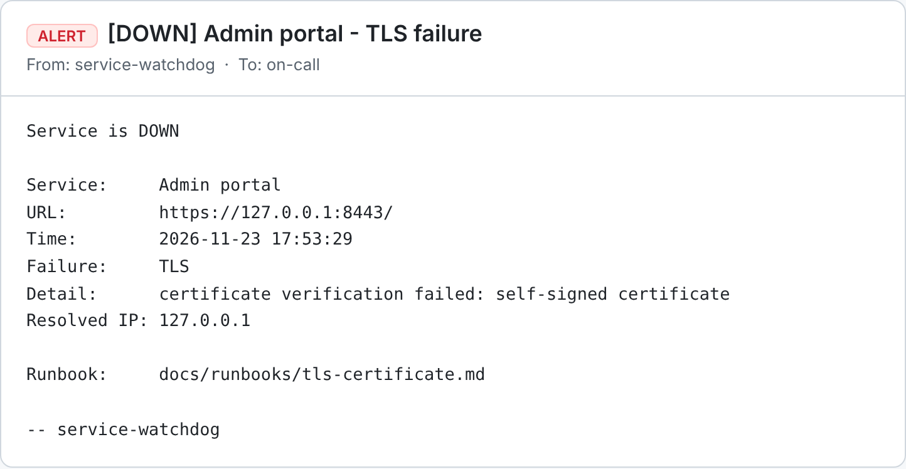
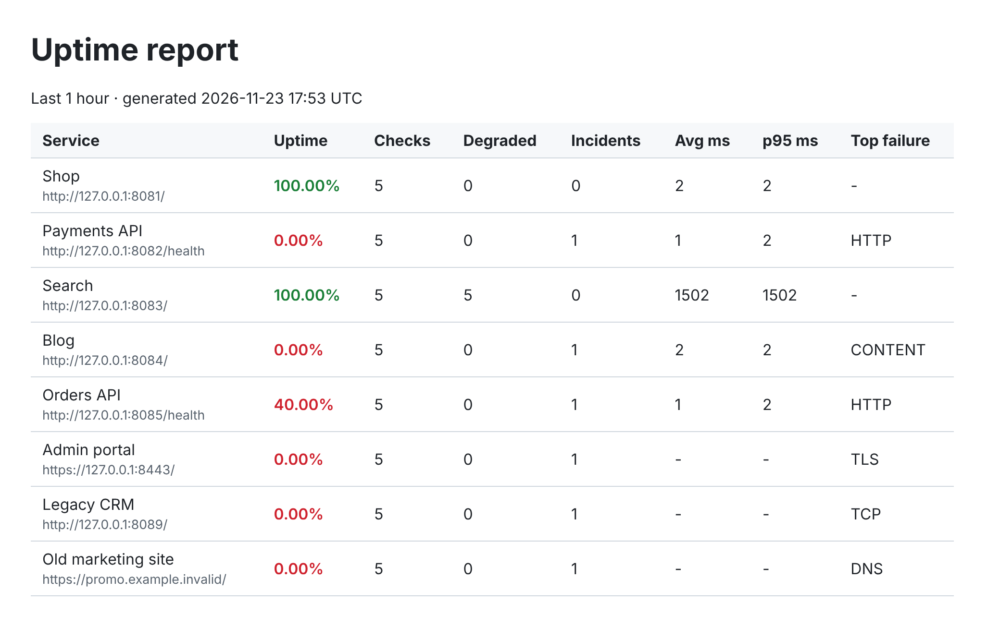

# service-watchdog

[](https://github.com/Joun-Mikhail/service-watchdog/actions/workflows/ci.yml)


An uptime monitor that tells you **why** a service is down, not just that it is.

Each check walks the network stack layer by layer — **DNS → TCP → TLS → HTTP** — so every alert names
the layer that failed and links to the runbook for fixing it. It runs as a Linux service, a Windows
scheduled task, a Docker container, or on AWS with CloudWatch and SNS.


---

## Try it in 30 seconds

The demo lab starts local services that each fail in a different way — server error, slow response,
maintenance page, flaky service, self-signed certificate — plus a stopped service and a dead domain.

```bash
git clone https://github.com/Joun-Mikhail/service-watchdog.git
cd service-watchdog
pip install -r requirements.txt

python demo/lab.py                                          # terminal 1
python watchdog.py --config demo/config.yaml --dry-run      # terminal 2
```

---

## How it works

```
watchdog.py ──► monitor.py ──► diagnostics.py   DNS lookup → TCP connect → TLS handshake
                    │                            then HTTP request: status, keyword, latency
                    ▼
                state.py      consecutive-failure tracking → DOWN / DEGRADED / RECOVERED events
                    │
                    ├──► alerter.py   email (SMTP) and/or AWS SNS, with diagnosis and runbook link
                    └──► history.py   every result to CSV → report.py uptime report
```

| Category | Meaning | Typical cause | Runbook |
|----------|---------|---------------|---------|
| `DNS` | Hostname does not resolve | Expired domain, deleted record, resolver issue | [dns-failure](docs/runbooks/dns-failure.md) |
| `TCP` | Port refused, filtered or unreachable | Service stopped, firewall, security group | [connection-failure](docs/runbooks/connection-failure.md) |
| `TLS` | Handshake or certificate validation fails | Expired / self-signed / incomplete chain | [tls-certificate](docs/runbooks/tls-certificate.md) |
| `HTTP` | Wrong status code or no response | 5xx errors, bad deploy, overload | [http-errors](docs/runbooks/http-errors.md) |
| `CONTENT` | Expected text missing from the page | Maintenance page, error page served with 200 | [http-errors](docs/runbooks/http-errors.md) |
| `LATENCY` | Slower than the configured limit | Resource exhaustion, slow dependency | [high-latency](docs/runbooks/high-latency.md) |
| `TLS_EXPIRING` | Certificate expires soon | Renewal not automated or failing | [tls-certificate](docs/runbooks/tls-certificate.md) |

### Alerts

An alert is sent after `failure_threshold` consecutive failures (one blip does not page anyone),
once per incident, followed by a recovery notice with the total downtime.



### Uptime report

Every check is recorded; `report.py` summarises uptime, degraded checks, incidents and latency per service.



```bash
python report.py                                       # last 24 hours, text table
python report.py --hours 168 --html reports/weekly.html
```

---

## Features

- **Layered diagnostics** — failures classified as `DNS`, `TCP`, `TLS`, `HTTP`, `CONTENT` or `LATENCY`
- **Certificate monitoring** — warns before TLS certificates expire
- **Content and latency checks** — catch maintenance pages and slow responses, not just hard outages
- **Noise control** — alerts only after N consecutive failures, once per incident, with recovery notices
- **Email and AWS SNS** alerts — one failing channel never blocks the other
- **Structured logs** — `key=value` lines, easy to grep or query in CloudWatch Logs Insights, rotated automatically
- **Scriptable** — `--once` exits non-zero when something is down, for cron jobs and CI pipelines
- **Runs anywhere** — Docker, hardened systemd service, Windows Task Scheduler, or AWS via Terraform

---

## Usage

```bash
cp .env.example .env                    # add alert credentials
python watchdog.py --once --dry-run     # one round, no alerts sent
python watchdog.py                      # run continuously
```

| Flag | Description |
|------|-------------|
| `--config` | Path to the config file (default `config.yaml`) |
| `--once` | Run one round and exit |
| `--dry-run` | Log alerts instead of sending them |

Exit codes: `0` all healthy · `1` at least one target down · `2` configuration error.

### Configuration

`config.yaml`:

```yaml
check_interval: 5            # minutes between rounds
timeout: 10                  # seconds per network operation
failure_threshold: 2         # consecutive failures before alerting
tls_expiry_warning_days: 14

targets:
  - name: Public API
    url: https://api.example.com/health
    expected_status: 200
    keyword: "ok"            # must appear in the response body
    max_latency_ms: 1500     # slower responses are reported as DEGRADED

  - https://www.example.com  # plain URL: expects status 200

email:
  smtp_server: smtp.gmail.com
  smtp_port: 587
```

`.env` (git-ignored) — configure email, SNS, or both:

```
SENDER_EMAIL=your-email@gmail.com
SENDER_PASSWORD=your-app-password
RECIPIENT_EMAIL=alerts@your-team.com

# Optional: AWS SNS (pip install -r requirements-aws.txt)
ALERT_SNS_TOPIC_ARN=arn:aws:sns:eu-central-1:123456789012:service-watchdog-alerts
```

For Gmail, use an [App Password](https://support.google.com/accounts/answer/185833), not your account password.

---

## Deployment

Every method below is installed and verified automatically in CI.

### Docker

```bash
cp .env.example .env
docker compose up -d --build
docker compose logs -f
```

Runs as an unprivileged user; `config.yaml` is mounted read-only and logs persist in `./logs`.

### Linux (systemd)

```bash
sudo ./deploy/linux/install.sh
journalctl -u service-watchdog -f
```

Installs to `/opt/service-watchdog` with its own virtual environment and a dedicated `watchdog` system
user. The unit is sandboxed (`ProtectSystem=strict`, `NoNewPrivileges`, write access to `logs/` only),
restarts on failure, and does not restart-loop on a bad config. A systemd timer writes the daily
uptime report at 07:00.

### Windows (Task Scheduler)

From an elevated PowerShell in the repository folder:

```powershell
.\deploy\windows\Install-WatchdogTask.ps1
Get-Content .\logs\watchdog.log -Tail 20 -Wait
```

Registers a task that starts at boot and restarts on failure, plus a daily report task. No stored
password (S4U logon). Remove with `-Uninstall`.

### AWS (Terraform)

```bash
cd infra/aws
cp terraform.tfvars.example terraform.tfvars   # set alert_email and targets
terraform init && terraform apply
```

EC2 with **no SSH and no inbound ports** (access through SSM Session Manager), a least-privilege IAM
role, IMDSv2, an encrypted disk, alerts through SNS, logs and a dashboard in CloudWatch, a
"watchdog silent" alarm that catches the monitor itself failing, and automatic instance recovery.
Details: **[docs/aws-deployment.md](docs/aws-deployment.md)**.

---

## Documentation

| Document | Contents |
|----------|----------|
| [Runbooks](docs/runbooks/README.md) | Step-by-step response for every alert category, with Linux and Windows commands |
| [Troubleshooting toolkit](docs/troubleshooting.md) | DNS / TCP / TLS / HTTP and server-side commands, layer by layer |
| [AWS deployment](docs/aws-deployment.md) | Architecture, deploy, Logs Insights queries, troubleshooting, cost |
| [Postmortem template](docs/postmortem-template.md) | Blameless incident review format |
| [Postmortem example](docs/postmortem-example.md) | Worked example built from a demo-lab failure |

---

## What this project covers

| Area | Where |
|------|-------|
| Network troubleshooting (DNS, TCP, TLS, HTTP) | `diagnostics.py`, `monitor.py`, [troubleshooting toolkit](docs/troubleshooting.md) |
| Monitoring and alerting design (thresholds, de-duplication, recovery) | `state.py`, `alerter.py` |
| Incident response and documentation | [runbooks](docs/runbooks/README.md), [postmortems](docs/postmortem-template.md) |
| Linux administration (systemd, service hardening, journald) | `deploy/linux/` |
| Windows administration (PowerShell, Task Scheduler) | `deploy/windows/` |
| Containers | `Dockerfile`, `docker-compose.yml` |
| AWS (EC2, IAM, SNS, CloudWatch, SSM) and infrastructure as code | `infra/aws/` |
| Logging, metrics and reporting | `logger.py`, `history.py`, `report.py` |
| Automated testing and CI/CD | `tests/`, `.github/workflows/ci.yml` |

---

## Development

```bash
pip install -r requirements.txt -r requirements-dev.txt
pytest          # unit tests + end-to-end tests against the demo lab
ruff check .    # lint
```

CI runs on every push and pull request: lint, tests on Python 3.10 – 3.13, a Docker build, real
installs of the systemd service (Ubuntu) and the scheduled tasks (Windows), and Terraform validation.

### Project structure

```
watchdog.py        entry point, CLI and scheduling loop
config.py          config loading and validation
monitor.py         runs a check and classifies the result
diagnostics.py     DNS, TCP and TLS checks
state.py           failure threshold and incident tracking
alerter.py         alert formatting, SMTP and SNS delivery
logger.py          rotating file + console logging
history.py         CSV check history
report.py          uptime report (text / HTML)
demo/              local failure lab and demo config
deploy/linux/      systemd units and installer
deploy/windows/    Task Scheduler installer
infra/aws/         Terraform for EC2, IAM, SNS and CloudWatch
docs/              runbooks, troubleshooting, deployment guides, postmortems
tests/             pytest suite
```

### Known limitations

- DNS, TCP and TLS checks connect directly, so on networks that only allow outbound traffic through
  an HTTP proxy they report failures even when the site is reachable through the proxy.

---

## License

[MIT](LICENSE)
