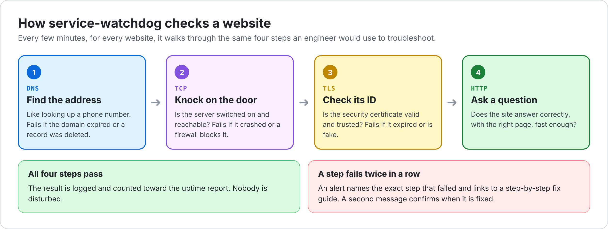
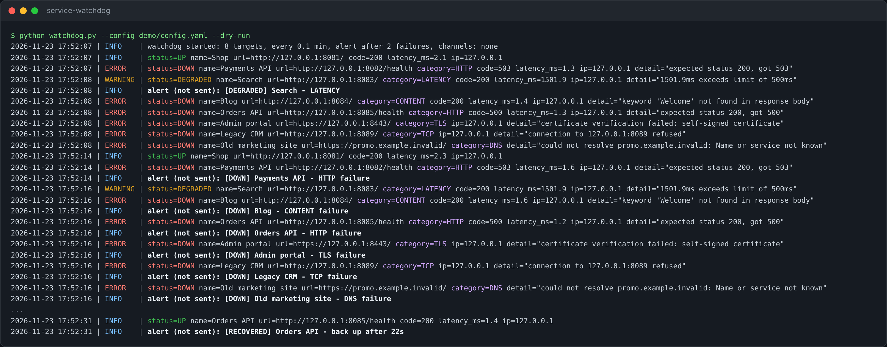
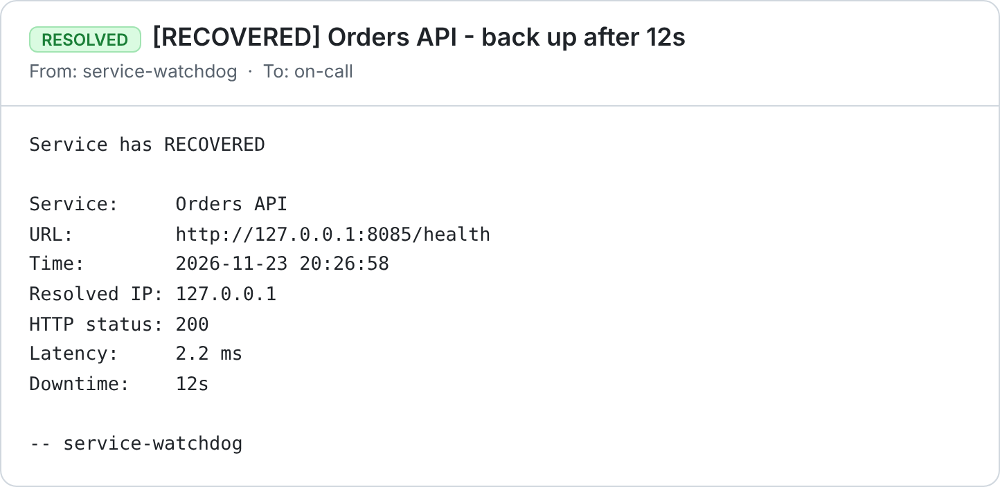
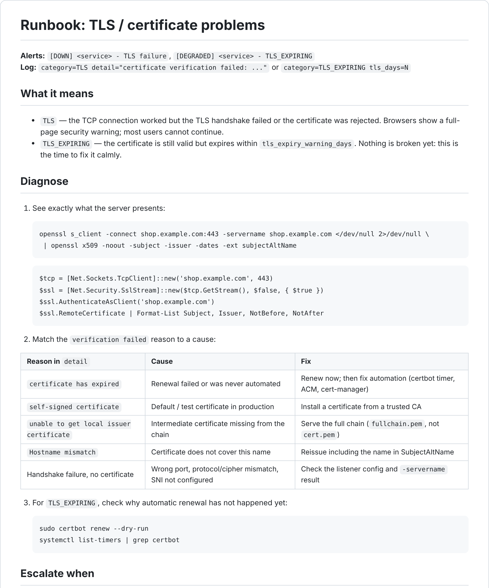
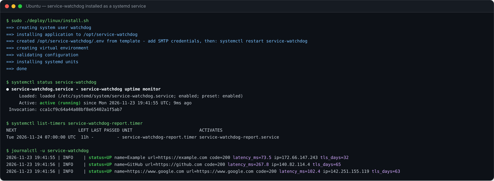
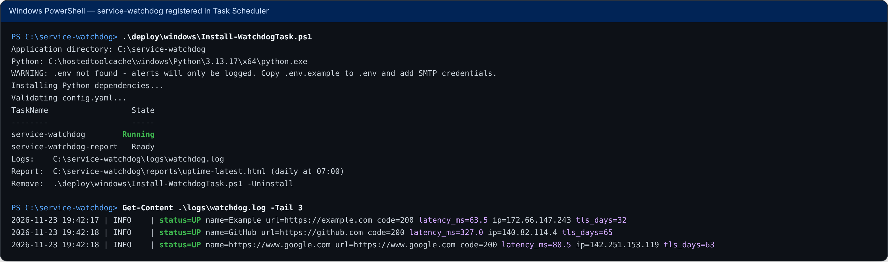
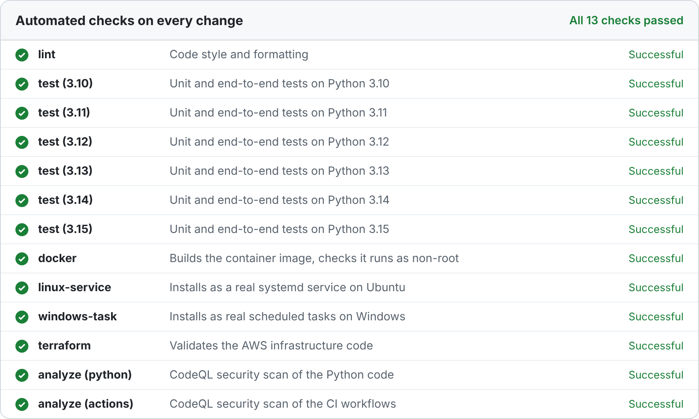
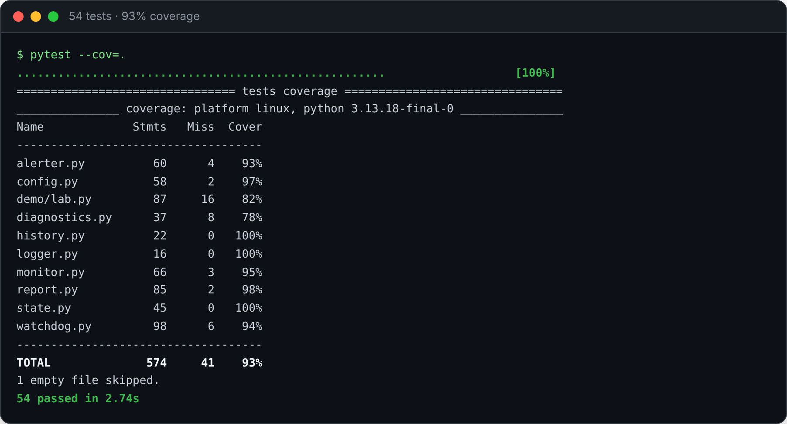

<div align="center">

# service-watchdog

### Know the moment a website goes down — and exactly why.

[](https://github.com/Joun-Mikhail/service-watchdog/actions/workflows/ci.yml)
[](https://github.com/Joun-Mikhail/service-watchdog/actions/workflows/codeql.yml)


</div>

---

## In plain English

Websites and online services break all the time — a server crashes, a security certificate
expires, a domain is not renewed, a bad update goes out. Usually customers notice first.

**service-watchdog watches your services around the clock.** When something breaks it does not
just say *"the site is down"* — it pinpoints **which step failed**, sends an alert with a link to a
**step-by-step fix guide**, and sends a second message when the service is back, including how long
it was down.

> Think of a smoke detector that also tells you **which room** the fire is in and hands you the
> instructions for putting it out.



### Why it matters

| | |
|---|---|
| **Faster fixes** | The alert names the broken step (address, connection, security certificate, or the website itself), so the engineer starts in the right place instead of guessing. Less downtime means less lost business. |
| **No false alarms** | A single hiccup does not wake anyone up. An alert is sent only when a problem repeats, and only once per incident. |
| **Proof of reliability** | Every check is recorded, producing an uptime report managers can read at a glance. |
| **Runs anywhere** | On a Linux server, a Windows machine, in a Docker container, or in the AWS cloud — every option is tested automatically. |

---

## What it looks like

All screenshots are real output from the project.

### 1. It catches every kind of failure

Eight services, each broken in a different way, all diagnosed in a single pass:
server error, slow response, maintenance page, failing service, untrusted certificate,
stopped server, and a dead domain.



### 2. The alert an engineer receives — and the all-clear

<table>
<tr>
<td width="50%"></td>
<td width="50%"></td>
</tr>
<tr>
<td align="center"><b>Problem found</b> — what broke, why, and which guide to follow</td>
<td align="center"><b>Problem solved</b> — confirmation with total downtime</td>
</tr>
</table>

### 3. An uptime report anyone can read

Uptime percentage, slow periods, incidents and response times for every service.


### 4. A step-by-step fix guide for every alert

Each alert links to a runbook: what it means, how to diagnose it on Linux and Windows,
common causes and fixes, when to escalate, and how to confirm it is fixed.



### 5. Installed as a real service on Linux and Windows

<details open>
<summary><b>Linux</b> — installed as a background service that starts on boot, checking live websites</summary>



</details>

<details>
<summary><b>Windows</b> — registered in Task Scheduler, checking the same live websites</summary>



</details>

### 6. Quality checked automatically on every change

<table>
<tr>
<td width="55%"></td>
<td width="45%"></td>
</tr>
<tr>
<td align="center">13 automated checks: tests, security scan, real Linux and Windows installs, cloud config</td>
<td align="center">54 automated tests, 93% of the code covered</td>
</tr>
</table>

---

## Skills this project demonstrates

| Skill | Evidence in this project |
|-------|--------------------------|
| **Troubleshooting methodology** | Every check follows the same layered approach a support engineer uses: DNS → connection → certificate → application |
| **Networking** | DNS resolution, TCP connectivity, TLS/SSL certificates, HTTP status codes and latency |
| **Monitoring and alerting** | Failure thresholds, one alert per incident, recovery notices, uptime and latency reporting |
| **Incident management** | [Runbooks](docs/runbooks/README.md) for every alert type, a [blameless postmortem template](docs/postmortem-template.md) and a [worked example](docs/postmortem-example.md) |
| **Technical documentation** | Runbooks, [troubleshooting toolkit](docs/troubleshooting.md), [AWS deployment guide](docs/aws-deployment.md) |
| **Linux administration** | systemd service with security hardening, dedicated service user, journald logging, scheduled timer |
| **Windows administration** | PowerShell installer, Task Scheduler with automatic restart, no stored passwords |
| **Cloud (AWS)** | EC2, IAM least privilege, CloudWatch logs, metrics, alarms and dashboard, SNS notifications, SSM Session Manager |
| **Infrastructure as Code** | Terraform for the complete AWS setup |
| **Containers** | Docker image running as a non-root user, Docker Compose |
| **Scripting and automation** | Python, Bash and PowerShell |
| **Security practices** | No SSH or open inbound ports on AWS, secrets kept out of the code, CodeQL scanning, Dependabot updates |
| **Quality and CI/CD** | 54 automated tests with a 90% coverage gate, GitHub Actions on Linux and Windows |

---

## Try it yourself in 30 seconds

Requires Python 3.10 or newer.

```bash
git clone https://github.com/Joun-Mikhail/service-watchdog.git
cd service-watchdog
pip install -r requirements.txt
```

Start the demo services, each broken in a different way:

```bash
python demo/lab.py
```

In a second terminal, watch the watchdog diagnose them:

```bash
python watchdog.py --config demo/config.yaml --dry-run
```

---

## For engineers

<details>
<summary><b>How it works</b></summary>

```
watchdog.py ──► monitor.py ──► diagnostics.py   DNS lookup → TCP connect → TLS handshake
                    │                            then HTTP request: status, keyword, latency
                    ▼
                state.py      consecutive-failure tracking → DOWN / DEGRADED / RECOVERED events
                    │
                    ├──► alerter.py   email (SMTP) and/or AWS SNS, with diagnosis and runbook link
                    └──► history.py   every result to CSV → report.py uptime report
```

| Category | Meaning | Typical cause | Runbook |
|----------|---------|---------------|---------|
| `DNS` | Hostname does not resolve | Expired domain, deleted record, resolver issue | [dns-failure](docs/runbooks/dns-failure.md) |
| `TCP` | Port refused, filtered or unreachable | Service stopped, firewall, security group | [connection-failure](docs/runbooks/connection-failure.md) |
| `TLS` | Handshake or certificate validation fails | Expired / self-signed / incomplete chain | [tls-certificate](docs/runbooks/tls-certificate.md) |
| `HTTP` | Wrong status code or no response | 5xx errors, bad deploy, overload | [http-errors](docs/runbooks/http-errors.md) |
| `CONTENT` | Expected text missing from the page | Maintenance page, error page served with 200 | [http-errors](docs/runbooks/http-errors.md) |
| `LATENCY` | Slower than the configured limit | Resource exhaustion, slow dependency | [high-latency](docs/runbooks/high-latency.md) |
| `TLS_EXPIRING` | Certificate expires soon | Renewal not automated or failing | [tls-certificate](docs/runbooks/tls-certificate.md) |

Logs are structured `key=value` lines, easy to grep or query in CloudWatch Logs Insights, and rotate automatically.

</details>

<details>
<summary><b>Usage and configuration</b></summary>

```bash
cp .env.example .env                    # add alert credentials
python watchdog.py --once --dry-run     # one round, no alerts sent
python watchdog.py                      # run continuously
python report.py --hours 24             # uptime report (add --html report.html for a web page)
```

| Flag | Description |
|------|-------------|
| `--config` | Path to the config file (default `config.yaml`) |
| `--once` | Run one round and exit |
| `--dry-run` | Log alerts instead of sending them |

Exit codes: `0` all healthy · `1` at least one target down · `2` configuration error.

`config.yaml`:

```yaml
check_interval: 5            # minutes between rounds
timeout: 10                  # seconds per network operation
failure_threshold: 2         # consecutive failures before alerting
tls_expiry_warning_days: 14

targets:
  - name: Public API
    url: https://api.example.com/health
    expected_status: 200
    keyword: "ok"            # must appear in the response body
    max_latency_ms: 1500     # slower responses are reported as DEGRADED

  - https://www.example.com  # plain URL: expects status 200

email:
  smtp_server: smtp.gmail.com
  smtp_port: 587
```

`.env` (git-ignored) — configure email, SNS, or both:

```
SENDER_EMAIL=your-email@gmail.com
SENDER_PASSWORD=your-app-password
RECIPIENT_EMAIL=alerts@your-team.com

# Optional: AWS SNS (pip install -r requirements-aws.txt)
ALERT_SNS_TOPIC_ARN=arn:aws:sns:eu-central-1:123456789012:service-watchdog-alerts
```

For Gmail, use an [App Password](https://support.google.com/accounts/answer/185833), not your account password.

</details>

<details>
<summary><b>Deployment: Docker, Linux, Windows, AWS</b></summary>

Every method below is installed and verified automatically in CI.

**Docker**

```bash
cp .env.example .env
docker compose up -d --build
docker compose logs -f
```

Runs as an unprivileged user; `config.yaml` is mounted read-only and logs persist in `./logs`.

**Linux (systemd)**

```bash
sudo ./deploy/linux/install.sh
journalctl -u service-watchdog -f
```

Installs to `/opt/service-watchdog` with its own virtual environment and a dedicated `watchdog` system
user. The unit is sandboxed (`ProtectSystem=strict`, `NoNewPrivileges`, write access to `logs/` only),
restarts on failure, and does not restart-loop on a bad config. A systemd timer writes the daily
uptime report at 07:00.

**Windows (Task Scheduler)** — from an elevated PowerShell in the repository folder:

```powershell
.\deploy\windows\Install-WatchdogTask.ps1
Get-Content .\logs\watchdog.log -Tail 20 -Wait
```

Registers a task that starts at boot and restarts on failure, plus a daily report task. No stored
password (S4U logon). Remove with `-Uninstall`.

**AWS (Terraform)**

```bash
cd infra/aws
cp terraform.tfvars.example terraform.tfvars   # set alert_email and targets
terraform init && terraform apply
```

EC2 with no SSH and no inbound ports (access through SSM Session Manager), a least-privilege IAM
role, IMDSv2, an encrypted disk, alerts through SNS, logs and a dashboard in CloudWatch, a
"watchdog silent" alarm that catches the monitor itself failing, and automatic instance recovery.
Details: [docs/aws-deployment.md](docs/aws-deployment.md).

</details>

<details>
<summary><b>Documentation</b></summary>

| Document | Contents |
|----------|----------|
| [Runbooks](docs/runbooks/README.md) | Step-by-step response for every alert category, with Linux and Windows commands |
| [Troubleshooting toolkit](docs/troubleshooting.md) | DNS / TCP / TLS / HTTP and server-side commands, layer by layer |
| [AWS deployment](docs/aws-deployment.md) | Architecture, deploy, Logs Insights queries, troubleshooting, cost |
| [Postmortem template](docs/postmortem-template.md) | Blameless incident review format |
| [Postmortem example](docs/postmortem-example.md) | Worked example built from a demo-lab failure |
| [Changelog](CHANGELOG.md) | Release history |

</details>

<details>
<summary><b>Development and project structure</b></summary>

```bash
pip install -r requirements.txt -r requirements-dev.txt
pytest --cov=.   # unit tests + end-to-end tests against the demo lab
ruff check .     # lint
```

CI runs on every push and pull request: lint, tests with a 90% coverage gate on Python 3.10 – 3.15,
a Docker build, real installs of the systemd service (Ubuntu) and the scheduled tasks (Windows),
Terraform validation, and CodeQL security analysis. Dependabot keeps dependencies up to date.

```
watchdog.py        entry point, CLI and scheduling loop
config.py          config loading and validation
monitor.py         runs a check and classifies the result
diagnostics.py     DNS, TCP and TLS checks
state.py           failure threshold and incident tracking
alerter.py         alert formatting, SMTP and SNS delivery
logger.py          rotating file + console logging
history.py         CSV check history
report.py          uptime report (text / HTML)
demo/              local failure lab and demo config
deploy/linux/      systemd units and installer
deploy/windows/    Task Scheduler installer
infra/aws/         Terraform for EC2, IAM, SNS and CloudWatch
docs/              runbooks, troubleshooting, deployment guides, postmortems
tests/             pytest suite
```

**Known limitation:** DNS, TCP and TLS checks connect directly, so on networks that only allow outbound
traffic through an HTTP proxy they report failures even when the site is reachable through the proxy.

</details>

---

<div align="center">

Released under the [MIT License](LICENSE)

</div>
