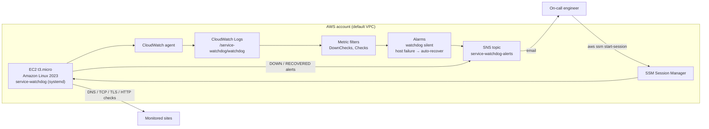

# Deploying service-watchdog on AWS

This guide deploys service-watchdog to a single EC2 instance with Terraform. Alerts go to an SNS
topic (email subscription), logs go to CloudWatch, and there are **no SSH keys and no open inbound
ports** — the instance is reached through SSM Session Manager.

## Architecture



| Resource | Purpose |
|----------|---------|
| EC2 instance | Runs the watchdog as a hardened systemd service (IMDSv2 only, encrypted root volume) |
| IAM role | `AmazonSSMManagedInstanceCore` plus a least-privilege policy: write to one log group, publish to one topic |
| Security group | No inbound rules at all; outbound only, for the health checks |
| CloudWatch Logs | Central log storage, 14-day retention, queryable with Logs Insights |
| Metric filters | Turn `status=DOWN` log lines into the `DownChecks` metric and every check into a `Checks` heartbeat |
| Alarm: watchdog silent | Fires if the watchdog logs nothing for 3 intervals — catches the monitor itself dying |
| Alarm: instance recover | Moves the instance to healthy hardware if AWS detects a host failure |
| SNS topic | Delivers alerts by email; no SMTP passwords stored anywhere |
| Dashboard | Failed checks, heartbeat and the most recent failures on one screen |

## Prerequisites

- An AWS account and the [AWS CLI](https://docs.aws.amazon.com/cli/latest/userguide/getting-started-install.html)
  configured (`aws configure`) with permission to create the resources above
- [Terraform](https://developer.hashicorp.com/terraform/install) 1.6 or newer
- The [Session Manager plugin](https://docs.aws.amazon.com/systems-manager/latest/userguide/session-manager-working-with-install-plugin.html)
  for the AWS CLI (only needed to open a shell on the instance)

## Deploy

```bash
cd infra/aws
cp terraform.tfvars.example terraform.tfvars   # set alert_email and your targets
terraform init
terraform plan
terraform apply
```

1. AWS sends a **"Subscription Confirmation"** email to `alert_email` — click the link, or no alerts arrive.
2. The instance bootstraps in about 2–3 minutes. Then follow the logs:

```bash
$(terraform output -raw tail_logs_command)
```

## Operate

| Task | Command |
|------|---------|
| Shell on the instance | `$(terraform output -raw connect_command)` |
| Service status | `sudo systemctl status service-watchdog` |
| Service logs | `sudo journalctl -u service-watchdog -f` |
| Bootstrap log | `sudo cat /var/log/watchdog-bootstrap.log` |
| Change targets | edit `targets` in `terraform.tfvars`, then `terraform apply` (replaces the instance) |
| Uptime report | `sudo -u watchdog /opt/service-watchdog/venv/bin/python /opt/service-watchdog/report.py --history /opt/service-watchdog/logs/history.csv` |

### Useful CloudWatch Logs Insights queries

Failures in the last 24 hours, by service and failure type:

```
fields @message
| filter @message like /status=DOWN/
| parse @message "name=* url=* category=* " as service, url, category
| stats count(*) as failures by service, category
| sort failures desc
```

Average and worst latency per service:

```
fields @message
| filter @message like /latency_ms=/
| parse @message "name=* url=" as service
| parse @message "latency_ms=* " as latency
| stats avg(latency) as avg_ms, max(latency) as max_ms by service
```

## Troubleshooting

| Symptom | Likely cause | Check |
|---------|--------------|-------|
| No alert emails | SNS subscription not confirmed | SNS console → Subscriptions → status must be *Confirmed* |
| Instance not listed in Session Manager | SSM agent cannot reach AWS, or role not attached | Instance has a public IP and outbound 443; IAM role is attached; wait 5 minutes after launch |
| Log group empty | CloudWatch agent not running or bootstrap failed | `sudo /opt/aws/amazon-cloudwatch-agent/bin/amazon-cloudwatch-agent-ctl -a status`, then the bootstrap log |
| "watchdog silent" alarm | Service crashed or stopped logging | `systemctl status service-watchdog`, `journalctl -u service-watchdog -n 50` |
| `AccessDenied` publishing to SNS | Topic ARN in `/opt/service-watchdog/.env` does not match the policy | Compare `.env` with `terraform output sns_topic_arn` |

## Cost

With the default `t3.micro`, the instance is covered by the AWS Free Tier for eligible accounts.
Outside the Free Tier, expect roughly USD 8–10 per month in `eu-central-1` (instance, 8 GB gp3 volume,
a few MB of logs, two alarms and one dashboard). SNS email notifications are free for the first 1,000.

## Tear down

```bash
terraform destroy
```
